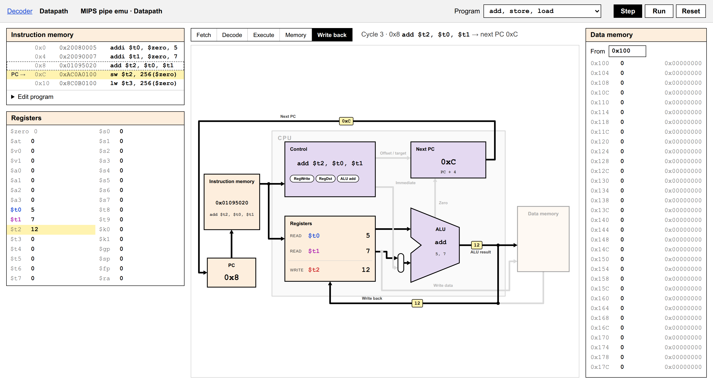
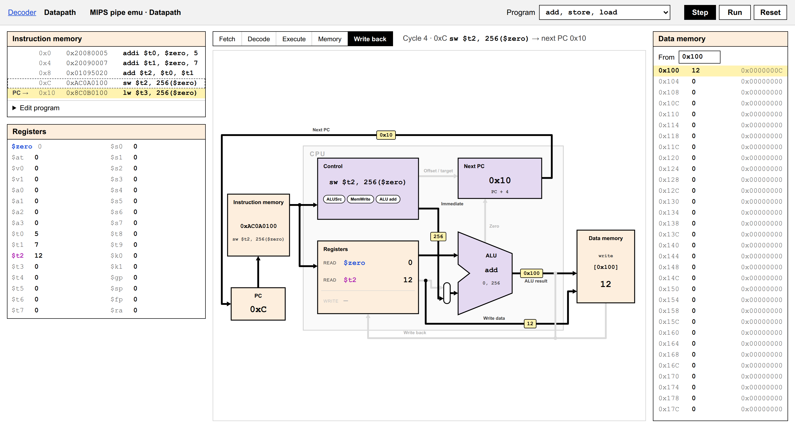
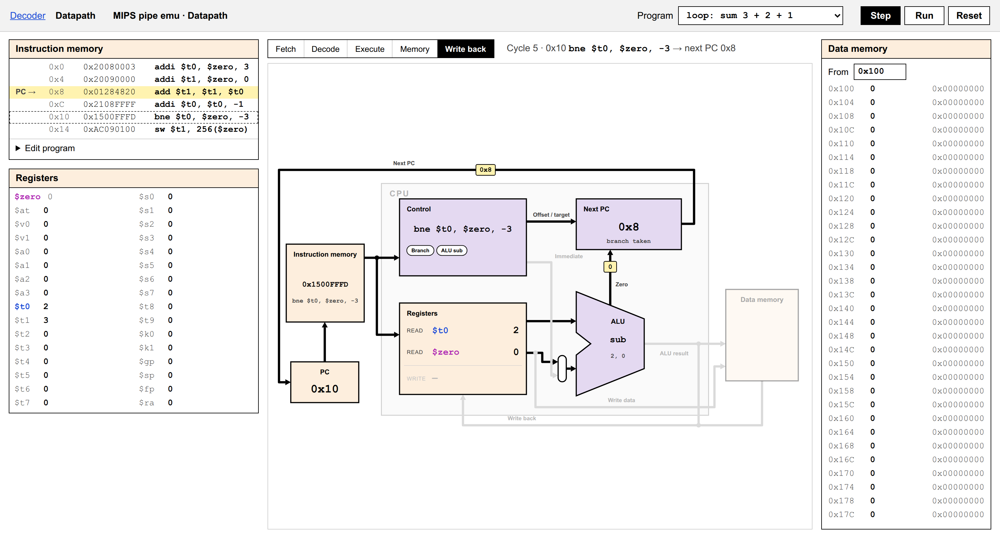
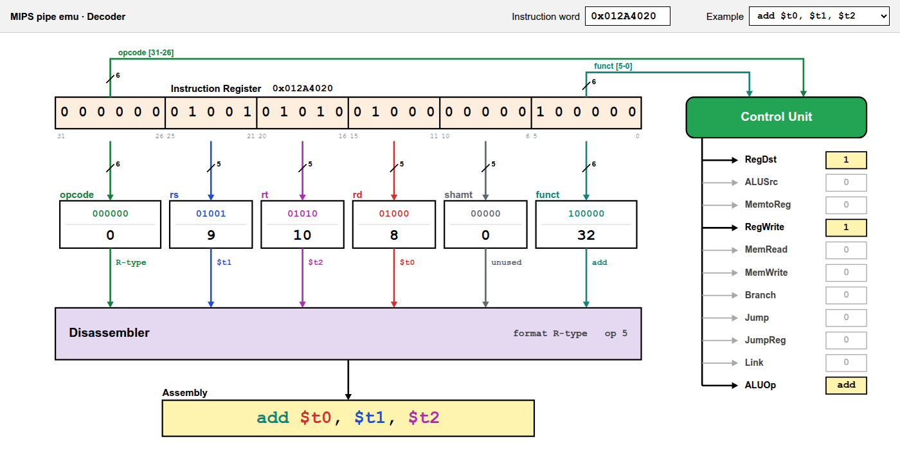
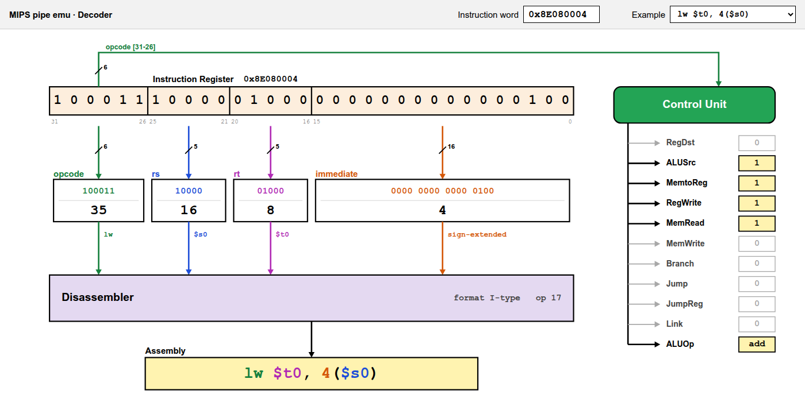
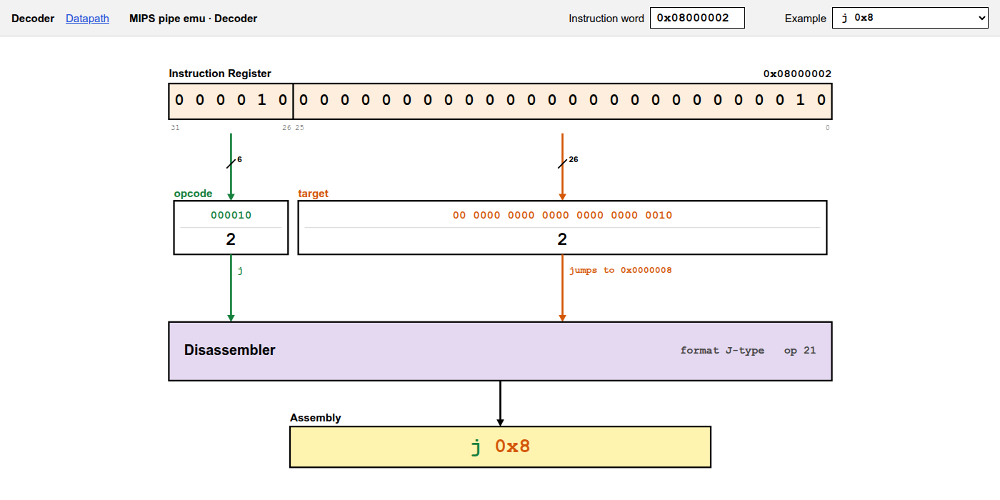

# MIPS Datapath & Pipeline Emulator

An educational 32-bit MIPS emulator that shows the datapath and the 5-stage pipeline (IF, ID, EX, MEM, WB).
The behavior follows the CE230 Computer Systems lectures (Lectures 18, 19, 21, and 22).

The core is plain C++17. The same code runs the unit tests and, compiled to WebAssembly, the web UI.

**Live demo:** [mips.shrestharajeev.com.np](http://mips.shrestharajeev.com.np/)

## Datapath

Step a program through the single-cycle datapath (Lecture 19). Every value on the page comes
from `Cpu::step()` in C++, compiled to WebAssembly: the page only draws the `StepTrace` it returns.

- **Instruction memory** (left): the loaded program with its disassembly. The highlighted row is
  the next instruction; the dashed row is the one that just ran.
- **Datapath** (middle): PC, instruction memory, control, registers, ALU, next-PC logic and data
  memory, joined by named buses. A bus turns black when it carries data, with its value in a
  yellow tag. Control shows only the signals that are on; blocks the instruction doesn't use fade out.
- **Registers** (left) and **data memory** (right): the written register or word is highlighted,
  and every value can be edited before the next step.
- **Step** (`S`) runs one instruction and plays it phase by phase: Fetch, Decode, Execute,
  Memory, Write back. **Run** (`R`) keeps stepping until the program ends. Click a phase to
  see the cycle up to that point.
- Pick one of the example programs or paste your own hex words under **Edit program**.
- If the trace disagrees with `decode()` and `control_for()`, or `step()` throws, the page says
  so above the figure.

### R-type: `add $t2, $t0, $t1`

Reads 5 and 7, the ALU adds them, and 12 is written back to `$t2`. Data memory is not used.



### Store: `sw $t2, 256($zero)`

The ALU adds the immediate 256 to `$zero` to form the address, and `$t2` goes to data memory as write data.



### Branch: `bne $t0, $zero, -3`

The ALU subtracts, Zero is 0, so the branch is taken and the next PC is `0x8`, the top of the loop.



## Decoder

Type a 32-bit instruction word or pick an example. The page splits the word into its fields,
names the registers, and disassembles it.

- Click any bit in the instruction register to flip it and see how the decode changes.
- The URL keeps the current word (`#0x8E080004`), so you can link to a specific instruction.

### R-type: `add $t0, $t1, $t2`



### I-type: `lw $t0, 4($s0)`



### J-type: `j 0x8`



## Status

- [x] Core: memory, register file, ALU, decoder, control unit
- [x] Single-cycle CPU with a per-instruction trace
- [x] Web UI: decoder (C++ core compiled to WebAssembly)
- [x] Web UI: step through a program on the single-cycle datapath
- [ ] 5-stage pipeline with pipeline registers
- [ ] Forwarding, load-use stalls, and branch/jump handling in ID

## Supported instructions

| Format | Instructions |
|---|---|
| R | `add` `sub` `and` `or` `xor` `nor` `slt` `sll` `srl` `sra` `jr` |
| I | `addi` `slti` `andi` `ori` `lui` `lw` `sw` `beq` `bne` |
| J | `j` `jal` |

## Bit-level implementation

The ALU and decoder work on the bits directly, the way the hardware does: subtraction and
comparisons are built from addition, XOR and the sign bit instead of C++'s `-` and `<`,
and instruction fields come out with shifts and masks.

**Subtraction** is addition of the two's complement (invert, add one):

```cpp
case AluOp::Sub:
    value = a + (~b + 1);
    break;
```

**Signed less-than** takes the sign bit of `a - b` and corrects it when the subtraction overflows.
Overflow happens when `a` and `b` have different signs and the result's sign differs from `a`:

```cpp
case AluOp::Slt: {
    std::int32_t difference = a + (~b + 1);
    std::int32_t v = ((a ^ b) & (a ^ difference)) >> 31;
    value = ((difference >> 31) ^ v) & 1;
    break;
}
```

**Unsigned less-than** computes the borrow out of bit 31:

```cpp
case AluOp::Sltu: {
    std::uint32_t difference = a + (~b + 1);
    value = ((~a & b) | (~(a ^ b) & difference)) >> 31;
    break;
}
```

**Arithmetic shift right** does a logical shift, then fills the vacated top bits with copies of the sign bit:

```cpp
case AluOp::Sra: {
    std::uint32_t is_negative = (a >> 31) & 1;
    std::uint32_t shamt = b & 31;
    std::uint32_t fill = is_negative ? ~(0xFFFFFFFFu >> shamt) : 0u;
    value = (a >> shamt) | fill;
    break;
}
```

**Decoding** pulls each field out of the 32-bit word with a shift and a mask, matching the bit
ranges in the decoder screenshots above:

```cpp
std::uint8_t opcode = (word >> 26) & 0x3F;   // bits 31-26
std::uint8_t rs     = (word >> 21) & 0x1F;   // bits 25-21
std::uint8_t rt     = (word >> 16) & 0x1F;   // bits 20-16
std::uint8_t rd     = (word >> 11) & 0x1F;   // bits 15-11
std::uint8_t shamt  = (word >> 6) & 0x1F;    // bits 10-6
std::uint8_t funct  = word & 0x3F;           // bits 5-0

std::uint32_t imm_zext = word & 0xFFFF;
std::int32_t  imm_sext = static_cast<std::int16_t>(imm_zext);
std::uint32_t target   = word & 0x03FFFFFF;
```

Full source: [`src/alu.cpp`](src/alu.cpp), [`src/decode.cpp`](src/decode.cpp).

## Build and test

Requires a C++17 compiler, CMake 3.16 or newer, and GoogleTest.

```bash
make test             # build everything and run the full suite
make decode           # run one unit's tests (also: regfile, memory, alu, control, cpu)
make probe WORD=0x8E080004   # print every field decode() returns
```

Or with CMake directly:

```bash
cmake -S . -B build
cmake --build build
ctest --test-dir build
```

## Web UI

Requires [Emscripten](https://emscripten.org/docs/getting_started/downloads.html) (`em++` on your PATH, or emsdk in `~/emsdk`) and Node 22.

```bash
cd web
npm install
npm run dev           # builds the WASM module, then starts Vite on localhost
```

Open `/index.html` for the decoder and `/datapath.html` for the datapath.

`web/scripts/build-wasm.sh` compiles the core (`src/alu.cpp`, `control.cpp`, `cpu.cpp`,
`decode.cpp`, `memory.cpp`, `regfile.cpp`) and `wasm/bindings.cpp` into
`web/src/wasm/mipscore.wasm`. `npm run dev` and `npm run build` rerun it, so a change in `src/`
shows up in the page on the next run.

The bindings use embind to expose:

- `decode(word)` and `registerName(reg)`
- `control(word)`: `mips::control_for()` for the decoded word
- `Machine`: a `mips::Cpu` the page can load, read and write (registers, memory, PC) and `step()`.
  `step()` returns the `StepTrace` as a plain object, with `error` set if the C++ threw.

`web/src/shared/core.ts` loads the module and wraps it in a typed `Core` interface.

Every push to `main` or `feature/web-ui` that touches `src/`, `wasm/` or `web/` is built by
GitHub Actions (`.github/workflows/pages.yml`) and deployed to GitHub Pages.

## Layout

```
src/
  memory.*      byte-addressable, big-endian memory
  regfile.*     32 registers, $zero hardwired to 0
  alu.*         ALU operations and the zero flag
  decode.*      instruction fields, opcodes, disassembly
  control.*     control-signal table (Lecture 19, slides 24-25)
  cpu.*         single-cycle CPU; step() returns a StepTrace
  encode.hpp    helpers for hand-assembling test programs
tests/          GoogleTest unit tests, one file per unit
tools/          probe_decode: command-line decoder (make probe)
wasm/           embind bindings that expose the core to JavaScript
web/            Vite + TypeScript front end
  src/pages/probe/      decoder page
  src/pages/datapath/   datapath page (diagram.ts draws the figure)
  src/shared/           WASM loader and page navigation
docs/           screenshots
```

## Notes on the model

- Branches are resolved in the ID stage, as in the lecture's improved design (Lecture 22). A taken branch or jump discards the instruction that followed it.
- Addresses are byte addresses. Word accesses must be 4-byte aligned.
- Overflow on `add` and `sub` wraps around. The trapping forms are not modeled.
- Floating-point arithmetic (Lecture 18, slides 2-6) is out of scope for this datapath.
